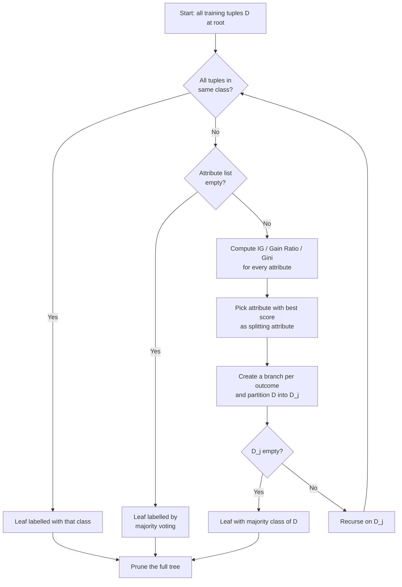
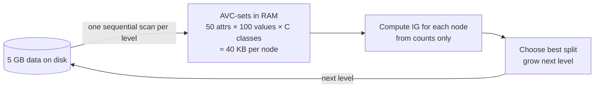
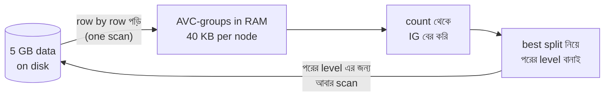
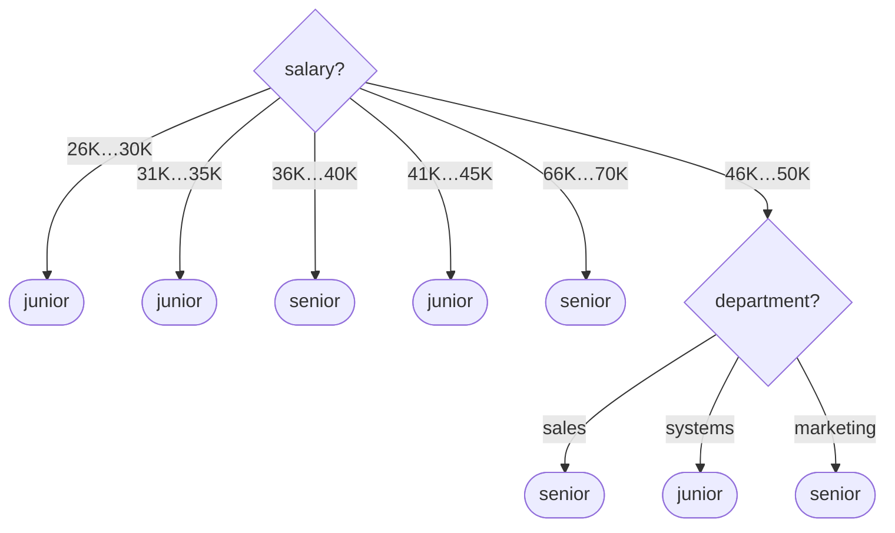
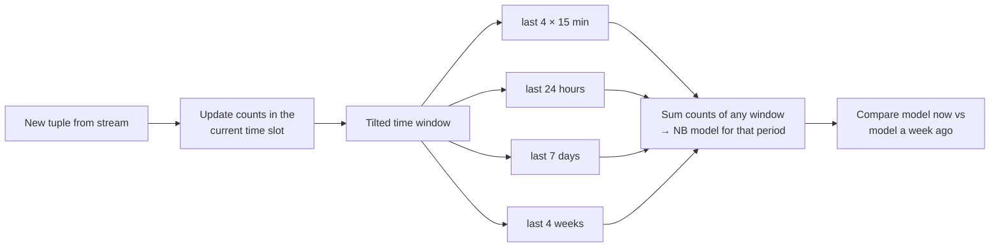
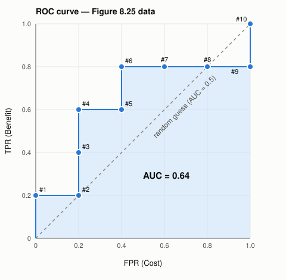
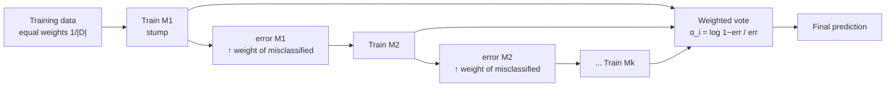

<br>
<br>

# `# Han - Data Mining (Chapter 8: Classification: Basic Concepts) - Exercise 8.1 to 8.15`

<br>

**Notation used (same as my notes):**
- **Entropy:** E(S) = −P(Yes)·log₂P(Yes) − P(No)·log₂P(No)
- **Information Gain:** IG = E(Parent) − {Weighted Average}·E(Children)
- **Naive Bayes:** P(C_k | X) ∝ P(C_k) · ∏ P(x_i | C_k),  ŷ = argmax_k P(C_k)·∏P(x_i|C_k)  (MAP rule)
- **Confusion Matrix:** TP, FP, TN, FN → TPR (Recall, Benefit), FPR (Cost), Precision (R₁), F1 (R₂)

<br>
<br>

# `# Part A: Questions`

<br>

**8.1** Briefly outline the major steps of *decision tree classification*.

**8.2** Why is *tree pruning* useful in decision tree induction? What is a drawback of using a separate set of tuples to evaluate pruning?

**8.3** Given a decision tree, you have the option of (a) *converting* the decision tree to rules and then pruning the resulting rules, or (b) *pruning* the decision tree and then converting the pruned tree to rules. What advantage does (a) have over (b)?

**8.4** It is important to calculate the worst-case computational complexity of the decision tree algorithm. Given data set, D, the number of attributes, n, and the number of training tuples, |D|, show that the computational cost of growing a tree is at most n × |D| × log(|D|).

**8.5** Given a 5 GB data set with 50 attributes (each containing 100 distinct values) and 512 MB of main memory in your laptop, outline an efficient method that constructs decision trees in such large data sets. Justify your answer by rough calculation of your main memory usage.

**8.6** Why is *naive Bayesian classification* called "naive"? Briefly outline the major ideas of naive Bayesian classification.

**8.7** The following table consists of training data from an employee database. The data have been generalized. For example, "31 … 35" for *age* represents the age range of 31 to 35. For a given row entry, *count* represents the number of data tuples having the values for *department*, *status*, *age*, and *salary* given in that row.

| department | status | age | salary | count |
|---|---|---|---|---|
| sales | senior | 31…35 | 46K…50K | 30 |
| sales | junior | 26…30 | 26K…30K | 40 |
| sales | junior | 31…35 | 31K…35K | 40 |
| systems | junior | 21…25 | 46K…50K | 20 |
| systems | senior | 31…35 | 66K…70K | 5 |
| systems | junior | 26…30 | 46K…50K | 3 |
| systems | senior | 41…45 | 66K…70K | 3 |
| marketing | senior | 36…40 | 46K…50K | 10 |
| marketing | junior | 31…35 | 41K…45K | 4 |
| secretary | senior | 46…50 | 36K…40K | 4 |
| secretary | junior | 26…30 | 26K…30K | 6 |

Let *status* be the class label attribute.
- (a) How would you modify the basic decision tree algorithm to take into consideration the *count* of each generalized data tuple (i.e., of each row entry)?
- (b) Use your algorithm to construct a decision tree from the given data.
- (c) Given a data tuple having the values "systems," "26…30," and "46–50K" for the attributes *department*, *age*, and *salary*, respectively, what would a naive Bayesian classification of the *status* for the tuple be?

**8.8** RainForest is a scalable algorithm for decision tree induction. Develop a scalable naive Bayesian classification algorithm that requires just a single scan of the entire data set for most databases. Discuss whether such an algorithm can be refined to incorporate *boosting* to further enhance its classification accuracy.

**8.9** Design an efficient method that performs effective naive Bayesian classification over an *infinite* data stream (i.e., you can scan the data stream only once). If we wanted to discover the *evolution* of such classification schemes (e.g., comparing the classification scheme at this moment with earlier schemes such as one from a week ago), what modified design would you suggest?

**8.10** Show that accuracy is a function of *sensitivity* and *specificity*, that is, prove Eq. (8.25).

**8.11** The harmonic mean is one of several kinds of averages. Chapter 2 discussed how to compute the *arithmetic mean*, which is what most people typically think of when they compute an average. The **harmonic mean**, H, of the positive real numbers, x₁, x₂, …, x_n, is defined as

H = n / (1/x₁ + 1/x₂ + … + 1/x_n) = n / Σᵢ₌₁ⁿ (1/xᵢ)

The F measure is the harmonic mean of precision and recall. Use this fact to derive Eq. (8.28) for F. In addition, write F_β as a function of true positives, false negatives, and false positives.

**8.12** The data tuples of Figure 8.25 are sorted by decreasing probability value, as returned by a classifier. For each tuple, compute the values for the number of true positives (TP), false positives (FP), true negatives (TN), and false negatives (FN). Compute the true positive rate (TPR) and false positive rate (FPR). Plot the ROC curve for the data.

| Tuple # | Class | Probability |
|---|---|---|
| 1 | P | 0.95 |
| 2 | N | 0.85 |
| 3 | P | 0.78 |
| 4 | P | 0.66 |
| 5 | N | 0.60 |
| 6 | P | 0.55 |
| 7 | N | 0.53 |
| 8 | N | 0.52 |
| 9 | N | 0.51 |
| 10 | P | 0.40 |

*Figure 8.25: Tuples sorted by decreasing score, where the score is the value returned by a probabilistic classifier.*

**8.13** It is difficult to assess classification *accuracy* when individual data objects may belong to more than one class at a time. In such cases, comment on what criteria you would use to compare different classifiers modeled after the same data.

**8.14** Suppose that we want to *select between two prediction models*, M₁ and M₂. We have performed 10 rounds of 10-fold cross-validation on each model, where the same data partitioning in round *i* is used for both M₁ and M₂. The error rates obtained for M₁ are 30.5, 32.2, 20.7, 20.6, 31.0, 41.0, 27.7, 26.0, 21.5, 26.0. The error rates for M₂ are 22.4, 14.5, 22.4, 19.6, 20.7, 20.4, 22.1, 19.4, 16.2, 35.0. Comment on whether one model is significantly better than the other considering a significance level of 1%.

**8.15** What is *boosting*? State why it may improve the accuracy of decision tree induction.

<br>
<br>

# `# Part B: Answers`

<br>
<br>

## `# 8.1 Major steps of decision tree classification`

<br>

A decision tree is just a set of nested if-else conditions. It is built top-down, recursively, in four steps (the pseudo code from my notes):

1. **Dataset (D):** Start at the root node with all training tuples.
2. **Best feature:** Use an attribute selection measure (Information Gain, Gain Ratio or Gini) to pick the splitting attribute. The attribute with the highest IG wins.
3. **Split the data:** According the best attribute split the data (for a numerical attribute, use a split point: `A ≤ v` and `A > v`).
4. **Recurse:** Repeat steps 1, 2 and 3 on each partition.

**Stopping conditions (make a leaf):**
- All tuples in the node belong to the same class (E = 0, pure).
- No attributes are left. Label the leaf by **majority voting**.
- A branch receives no tuples. Label the leaf with the parent's majority class.

After that, apply **tree pruning** to reduce overfitting. To classify a query, follow the path from the root to a leaf.



**"Label the leaf by majority voting" মানে হলো: leaf node এ যে class এর tuple সবচেয়ে বেশি, leaf টাকে সেই class দিয়ে label করা।

কখন দরকার হয়?

Normally আমরা ততক্ষণ split করি যতক্ষণ না node টা pure হয় (E = 0), মানে সব tuple একই class এর। তখন leaf এর class নিয়ে কোনো confusion থাকে না।

কিন্তু কখনো কখনো node এখনো impure থাকে (সব tuple একই class এর না), অথচ split করার মতো আর কোনো attribute বাকি নেই। তখন node টাকে leaf বানাতেই হবে। কিন্তু কোন class দিয়ে label করবো? তখন ভোট নেই: ওই node এ যে class এর tuple সংখ্যা বেশি, সেটাই জিতবে।**

<br>
<br>

## `# 8.2 Why is tree pruning useful? Drawback of a separate pruning set?`

<br>

**Why it is useful:** A fully grown tree fits the noise and outliers in the training data with extra nested if-else branches. This is **overfitting** (an LBHV model). Pruning removes the least reliable branches, so:
- the tree is smaller and simpler, and easier to understand,
- classification is faster,
- accuracy on unseen (test) data improves (better generalization).

**Drawback of a separate pruning set:** Holding out a separate set leaves less data for training. If the data set is small, the tree is built from even fewer tuples and may be poor. Also, if the pruning set is not representative of the whole data, pruning can go in the wrong direction.

<br>
<br>

## `# 8.3 Advantage of (a) Tree → Rules → Prune rules over (b) Prune tree → Rules`

<br>

When the tree is converted to rules first, every root-to-leaf path becomes an independent IF-THEN rule. Then:
- **Any condition (precondition) of any rule can be removed on its own.** In (b), pruning a node removes the **entire subtree** below it. You can only cut whole subtrees, and usually only near the leaves.
- The distinction between attribute tests near the root and tests near the leaves disappears. Pruning is no longer constrained by the tree structure, so it is **much more flexible**.
- The same test can be kept in one rule and dropped from another (in a tree it is shared by every path below it). The result is a more accurate and more readable rule set. This is how C4.5rules works.


8.3 এর মূল কথা হলো: **tree তে একটা condition অনেকগুলো path share করে, কিন্তু rule এ প্রতিটা path আলাদা।** তাই rule এ convert করলে pruning অনেক বেশি স্বাধীনভাবে করা যায়। চলো তোমার PlayTennis example দিয়ে দেখি।

### Tree টা

```
              Outlook?
      ┌──────────┼──────────┐
    Sunny     Overcast     Rain
      │          │          │
  Humidity?     Yes       Wind?
   ┌───┴───┐            ┌───┴───┐
  High   Normal       Strong   Weak
   │       │            │       │
   No     Yes           No     Yes
```

Root থেকে প্রতিটা leaf পর্যন্ত যে path, সেটাই একটা rule:

| Rule | IF | THEN |
|---|---|---|
| R1 | Outlook = Sunny **AND** Humidity = High | No |
| R2 | Outlook = Sunny **AND** Humidity = Normal | Yes |
| R3 | Outlook = Overcast | Yes |
| R4 | Outlook = Rain **AND** Wind = Strong | No |
| R5 | Outlook = Rain **AND** Wind = Weak | Yes |

### (b) আগে tree prune করলে কী হয়

Tree তে pruning মানে **একটা node এর নিচের পুরো subtree কেটে** সেখানে একটা leaf বসানো (majority voting দিয়ে)।

ধরো Humidity node টা কাটলাম, তাহলে Sunny → No হয়ে যাবে। এতে **R1 আর R2 দুইটাই একসাথে বদলে যায়।** R1 রাখবো আর শুধু R2 বদলাবো, এমন করা যায় না, কারণ দুইটা same node share করে।

আর **Outlook (root) টা কখনোই বাদ দেওয়া যায় না।** Root কাটলে পুরো tree চলে যায়, শুধু একটা leaf থাকে।

অর্থাৎ tree pruning হয় **all-or-nothing, নিচ থেকে উপরে।**

### (a) আগে rule এ convert করে তারপর prune করলে কী হয়

এখন প্রতিটা rule আলাদা, কেউ কারো সাথে জোড়া না। তাই **যে কোনো rule থেকে যে কোনো condition আলাদাভাবে বাদ দেওয়া যায়।** বাদ দেওয়ার পর validation accuracy না কমলেই হলো।

- **R1** থেকে "Outlook = Sunny" বাদ দিলাম:
  `IF Humidity = High THEN No`
  এখানে **root এর test টাই বাদ দিলাম**, কিন্তু শুধু এই একটা rule থেকে। Tree তে এটা অসম্ভব।
- **R2** একদম আগের মতো রেখে দিলাম। R1 বদলালেও R2 এর কিছু হয়নি।
- **R5** থেকে "Wind = Weak" বাদ দিলাম, কিন্তু **R4** তে Wind রেখে দিলাম।

### Summary

| | (b) Prune tree → Rules | (a) Tree → Rules → Prune |
|---|---|---|
| কী কাটা যায় | শুধু পুরো subtree | যে কোনো rule এর যে কোনো একটা condition |
| Root এর কাছের test | কাটা যায় না (কাটলে পুরো tree চলে যায়) | যে কোনো rule থেকে বাদ দেওয়া যায় |
| একটা path বদলালে | ওই node share করা সব path একসাথে বদলায় | শুধু ওই rule বদলায় |
| Flexibility | কম | **অনেক বেশি** |

**Simple analogy:** Tree হলো একটা গাছ। একটা ডাল কাটলে ওই ডালের সব পাতা একসাথে পড়ে যায়। আর rules হলো আলাদা আলাদা সুতো। যে কোনো সুতোর যে কোনো গিঁট আলাদাভাবে খোলা যায়, বাকি সুতোর কিছু হয় না।

এই কারণেই (a) ভালো: pruning এর আরও সূক্ষ্ম control পাওয়া যায়, তাই rule set বেশি accurate আর ছোট হয়। C4.5 (C4.5rules) এই পদ্ধতিই ব্যবহার করে।

<br>
<br>

## `# 8.4 Worst-case cost of growing a tree ≤ n × |D| × log(|D|)`

<br>

Let n = number of attributes and |D| = number of training tuples.

1. **Cost per level:** At any level of the tree, the partitions in all the nodes are disjoint. So the total number of tuples across a level is at most |D|. In each node, every one of the n attributes is evaluated, and each tuple is scanned once. So one level costs **O(n × |D|)**.
2. **Number of levels (depth):** In the worst case each split divides the data into at least two parts, so the maximum depth is **O(log |D|)**. (In my notes, query complexity is log₂n.)
3. **Total:** Add up the cost of all levels:

   Cost ≤ (number of levels) × (cost per level) = log(|D|) × n × |D| = **O(n × |D| × log(|D|))** ✅


8.4 তে দুইটা জিনিস প্রমাণ করতে হয়। PlayTennis dataset দিয়ে দুইটাই দেখাচ্ছি। এখানে **|D| = 14** (tuple সংখ্যা) আর **n = 4** (Outlook, Temperature, Humidity, Windy)।

## Step 1: একটা node এ কত কাজ হয়?

Root node এ Outlook এর IG বের করতে হলে 14 টা row একবার করে দেখে একটা count table ভরাতে হয়:

| Outlook | Yes | No |
|---|---|---|
| Sunny | 2 | 3 |
| Overcast | 4 | 0 |
| Rainy | 3 | 2 |

এটা ভরাতে **14 টা step** লাগে। তারপর entropy আর IG শুধু এই ছোট table থেকে বের হয়, row আর দেখতে হয় না।

একই কাজ 4 টা attribute এর জন্যই করতে হয়, তাই:

**Root এর cost = n × |D| = 4 × 14 = 56**

সাধারণভাবে: কোনো node এ |D_j| টা tuple থাকলে, ওই node এর cost = n × |D_j|।

## Step 2: পুরো একটা level এ কত কাজ হয়?

তোমার note এর tree টা level অনুযায়ী সাজালে:

```
Level 0:                    Outlook  [14]
                  ┌────────────┼────────────┐
Level 1:      Sunny [5]   Overcast [4]   Rainy [5]
                  │            │            │
              Humidity?       Yes        Windy?
               ┌───┴───┐                ┌───┴───┐
Level 2:   High [3] Normal [2]     False [3] True [2]
              No      Yes             Yes      No
```

এখানে key point টা হলো: **একটা level এর সব node এর tuple যোগ করলে কখনো |D| এর বেশি হয় না।** কারণ partition গুলো disjoint, একটা tuple একসাথে দুইটা branch এ যেতে পারে না।

| Level | Node গুলোর tuple | মোট | ≤ \|D\| ? |
|---|---|---|---|
| 0 | 14 | 14 | ✅ |
| 1 | 5 + 4 + 5 | 14 | ✅ |
| 2 | 3 + 2 + 3 + 2 | 10 | ✅ |

তাই প্রতি level এর cost:

n × (5 + 4 + 5) = n × 14 = n × |D|

**Per level cost ≤ n × |D|**

(বাস্তবে level 1 এ cost আরও কম: Overcast pure তাই ওখানে split লাগে না, আর Outlook already ব্যবহার হয়ে গেছে, তাই বাকি থাকে 3 টা attribute। Actual cost = 3 × (5 + 5) = 30, যা 56 এর চেয়ে কম। আমরা শুধু upper bound চাই, তাই সমস্যা নেই।)

## Step 3: Level কয়টা হতে পারে?

প্রতিবার split হলে data অন্তত দুই ভাগ হয়। Worst case এ প্রতিবার অর্ধেক ধরলে:

```
14 → 7 → 3.5 → 1.75 → ~1
```

মোটামুটি **log₂(14) ≈ 3.8** বার ভাগ করার পর প্রতিটা node এ 1 টা tuple থাকে, আর ভাগ করা যায় না। তাই:

**Depth ≤ log₂|D| ≈ 3.8**

আমাদের tree এর depth মাত্র 2, যা 3.8 এর চেয়ে কম। ✅

## Step 4: সব একসাথে

Total cost = (level সংখ্যা) × (প্রতি level এর cost)
          ≤ log|D| × n × |D|

PlayTennis এর জন্য সংখ্যা বসালে:

| | হিসাব | মান |
|---|---|---|
| **Upper bound** | n × \|D\| × log₂\|D\| = 4 × 14 × 3.8 | **≈ 213** |
| **Actual cost** | level 0: 4 × 14 = 56<br>level 1: 3 × (5 + 5) = 30<br>level 2: সব pure, তাই 0 | **= 86** |

86 ≤ 213, তাই **Cost ≤ n × |D| × log(|D|)** ✅

**এক লাইনে:** প্রতিটা level এ সব tuple মিলে মাত্র একবার করে দেখা হয় (n × |D|), আর level আছে বড়জোর log|D| টা। এই দুইটা গুণ করলেই answer।

> **একটা ছোট note:** Depth ≤ log|D| ধরে নেওয়াটা Han এর book এর assumption, যেখানে tree মোটামুটি balanced। খুব একপাশে হেলে থাকা tree এর depth এর চেয়ে বেশি হতে পারে। তবে exam এ book এর এই proof টাই লিখবে।

<br>
<br>

## `# 8.5 5 GB data, 50 attributes (100 distinct values each), 512 MB RAM`

<br>

The 5 GB data set cannot be loaded into RAM. But to choose a split we **do not need the raw tuples, only counts**: entropy and IG need only class counts. So we use **AVC-sets (Attribute–Value–Class label counts)**, as RainForest does.

**Method:**
1. Keep the data on disk. Do **one sequential scan per tree level**.
2. During the scan, update each node's AVC-group (one AVC-set for each of the 50 attributes): `count[attribute][value][class] += 1`.
3. After the scan, compute IG for every node from the in-memory counts and choose the best split.
4. Scan again for the next level, and continue recursively.

**Memory calculation (C = number of classes, 4 bytes per counter):**
- AVC-group of one node = 50 × 100 × C counters = 5000·C counters
- For C = 2: 10,000 counters × 4 B = **40 KB per node**
- 512 MB / 40 KB ≈ **13,000 nodes** can be held in RAM at the same time.

So one scan can handle a whole level with thousands of nodes, and the 5 GB of data never has to fit in RAM. The total number of disk scans ≈ the depth of the tree.




8.4 এর Step 1 এর কথা মনে আছে? IG বের করতে আমাদের **row গুলো লাগে না, শুধু count table লাগে।** 8.5 এর পুরো answer এই একটা idea এর উপর দাঁড়িয়ে।

## সমস্যাটা কী?

- Data = **5 GB**, কিন্তু RAM = **512 MB**
- পুরো data RAM এ load করা যাবে না, এটা প্রায় 10 গুণ বড়।

Normal decision tree algorithm (8.1) পুরো D কে memory তে রেখে split করে। এখানে সেটা সম্ভব না। তাহলে tree বানাবো কীভাবে?

## Key idea: row না রেখে শুধু count রাখো

PlayTennis এর root এ IG বের করতে আমাদের কী লেগেছিলো? শুধু এই ছোট table গুলো:

**Outlook**

| | Yes | No |
|---|---|---|
| Sunny | 2 | 3 |
| Overcast | 4 | 0 |
| Rainy | 3 | 2 |

**Humidity**

| | Yes | No |
|---|---|---|
| High | 3 | 4 |
| Normal | 6 | 1 |

…একইভাবে Temperature আর Windy এর জন্যও একটা করে table।

এই table গুলো দিয়েই entropy, weighted average আর IG সব বের হয়ে যায়। **14 টা row আর লাগে না।**

এই ধরনের table এর একটা নাম আছে:
- **AVC-set** = **A**ttribute–**V**alue–**C**lass count table (একটা attribute এর জন্য, যেমন উপরের Outlook table)
- **AVC-group** = একটা node এর সব attribute এর AVC-set একসাথে

**Analogy: ভোট গণনা।** 5 কোটি ব্যালট পেপার টেবিলে জমিয়ে রাখার দরকার নেই। একটা একটা করে পড়ো আর tally sheet এ দাগ দাও। শেষে শুধু tally sheet টা লাগে। Tally sheet এর size ব্যালট সংখ্যার উপর নির্ভর করে না, শুধু প্রার্থী কয়জন তার উপর নির্ভর করে।

## এখন question এর সংখ্যা বসাই

Question এ আছে: 50 টা attribute, প্রতিটার 100 টা distinct value। Class ধরি 2 টা (C = 2)।

একটা attribute এর AVC-set = 100 value × 2 class = **200 টা counter**।

একটা node এর AVC-group (50 টা attribute) = 50 × 200 = **10,000 টা counter**।

প্রতিটা counter একটা integer, 4 bytes:

10,000 × 4 B = **40 KB per node**

| | Size |
|---|---|
| পুরো data | 5 GB = 5,000,000 KB |
| একটা node এর AVC-group | **40 KB** |
| RAM | 512 MB ≈ 524,288 KB |

তাহলে RAM এ একসাথে AVC-group রাখা যায়:

512 MB / 40 KB ≈ **13,000 node এর**

**খেয়াল করো:** 40 KB এর হিসাবে কোথাও row সংখ্যা নেই। Data 5 GB হোক বা 500 GB, AVC-group 40 KB ই থাকবে, শুধু counter এর ভিতরের সংখ্যাটা বড় হবে। এটাই trick।

## Algorithm টা step by step

**Level 0 (root):**
1. Disk থেকে file টা row by row পড়ি (পুরোটা RAM এ নেই না, একবারে একটা row)।
2. প্রতিটা row এর জন্য counter বাড়াই। যেমন row টা যদি হয় (Sunny, …, Humidity = High, class = No), তাহলে `Outlook[Sunny][No] += 1`, `Humidity[High][No] += 1`, এভাবে 50 টা attribute এর জন্যই।
3. File শেষ হলে RAM এ শুধু 40 KB এর count table থাকে। এখান থেকে প্রতিটা attribute এর IG বের করি আর best টা বেছে নেই, ধরো Outlook।

**Level 1:**
4. File টা আবার শুরু থেকে পড়ি।
5. প্রতিটা row দেখে ঠিক করি এটা কোন child এ যাবে (Sunny / Overcast / Rainy), আর **শুধু ওই child এর** AVC-group এ counter বাড়াই।
6. File শেষ হলে প্রতিটা child এর IG বের করে split করি।

**Level 2, 3, …** একইভাবে চলবে। **প্রতি level এ disk এর উপর একটা করে scan।**



## এক level এ যদি অনেক node থাকে?

একটা level এ যতগুলো node আছে, সবার AVC-group একসাথে RAM এ রাখতে হবে, যাতে একটা scan এই সবগুলো ভরে যায়। প্রতিটা 40 KB, তাই 512 MB তে প্রায় **13,000 node** ধরে।

Practically একটা level এ এর চেয়ে বেশি node খুব কমই থাকে। তাই **এক scan = পুরো এক level।** কখনো বেশি হয়ে গেলে ওই level টা দুই ভাগে (দুইটা scan এ) করলেই হবে।

## Exam এর জন্য short answer

> Use RainForest's AVC-sets. To compute IG, only (attribute, value, class) counts are needed, not the raw tuples. One node's AVC-group = 50 × 100 × C counters. With C = 2 and 4 bytes per counter, that is 40 KB. So 512 MB can hold ≈ 13,000 nodes' AVC-groups at once. Scan the 5 GB file once per tree level, update counts, choose splits from the counts, and repeat. The data never has to fit in memory, and the number of scans equals the depth of the tree.

<br>
<br>

## `# 8.6 Why is naive Bayes called "naive"? Major ideas`

<br>

**Why "naive":** Bayes' theorem needs P(x₁, x₂, …, x_n | C_k) in the numerator. If a given combination never appears in the data, this probability is 0. In my CSK example, P(lost, mumbai, sunny | w) came out as 0. To avoid this, naive Bayes makes a **simplifying assumption**: given the class, the attributes are **conditionally independent** of each other:

P(x₁, x₂, …, x_n | C_k) = P(x₁|C_k) · P(x₂|C_k) · … · P(x_n|C_k)

In practice attributes are often dependent, so this assumption is "naive".

**Major ideas:**
1. Bayes' theorem: P(C_k | X) = P(X | C_k)·P(C_k) / P(X)
2. The denominator P(X) is the same for every class, so drop it.
3. Naive assumption: P(C_k | X) ∝ P(C_k) · ∏ᵢ P(x_i | C_k)
4. **MAP rule:** ŷ = argmax_k P(C_k) · ∏ᵢ P(x_i | C_k). The class with the largest value is the answer.
5. Categorical attribute: estimate the probability from counts. Numerical attribute: assume a **Gaussian distribution** and compute P(x_i | C_k) from it (the Height/Weight example in my notes).
6. If a probability is 0, apply the **Laplace correction** (add 1 to every count).

<br>
<br>

## `# 8.7 Employee database (generalized data with count)`

<br>

Class label = **status**. Total tuples = Σ count = 165, of which **senior = 52** and **junior = 113**.

<br>

### `(a) Modifying the algorithm to use count`

Each row actually stands for `count` identical tuples. So:
- When computing entropy and IG, **use the sum of count, not the number of rows**. For example, P(senior) = Σ count(senior) / Σ count(all).
- In the weighted average, the weight of a branch = |D_j| / |D| = (sum of counts in that branch) / (sum of counts in the parent).
- Majority voting at a leaf also uses the sum of counts.

The rest of the algorithm (the steps in 8.1) stays the same.

<br>

### `(b) Constructing the decision tree`

**Step 1: E(Parent) (root)**

E(S) = −(52/165)·log₂(52/165) − (113/165)·log₂(113/165)
     = −(0.3152 × −1.666) − (0.6848 × −0.546)
     ≈ 0.525 + 0.374 ≈ **0.899**

**Step 2: IG of each feature**

**1. department**
- sales: 110 → [senior 30, junior 80] → E = 0.845
- systems: 31 → [senior 8, junior 23] → E = 0.824
- marketing: 14 → [senior 10, junior 4] → E = 0.863
- secretary: 10 → [senior 4, junior 6] → E = 0.971

Weighted E = (110/165)(0.845) + (31/165)(0.824) + (14/165)(0.863) + (10/165)(0.971) ≈ **0.850**
IG(department) = 0.899 − 0.850 = **0.049**

**2. age**
- 21…25: 20 → [0, 20] → E = 0
- 26…30: 49 → [0, 49] → E = 0
- 31…35: 79 → [senior 35, junior 44] → E = 0.991
- 36…40: 10 → [10, 0] → E = 0
- 41…45: 3 → [3, 0] → E = 0
- 46…50: 4 → [4, 0] → E = 0

Weighted E = (79/165)(0.991) ≈ **0.474**
IG(age) = 0.899 − 0.474 = **0.425**

**3. salary**
- 26K…30K: 46 → [0, 46] → E = 0
- 31K…35K: 40 → [0, 40] → E = 0
- 36K…40K: 4 → [4, 0] → E = 0
- 41K…45K: 4 → [0, 4] → E = 0
- 46K…50K: 63 → [senior 40, junior 23] → E = 0.947
- 66K…70K: 8 → [8, 0] → E = 0

Weighted E = (63/165)(0.947) ≈ **0.362**
IG(salary) = 0.899 − 0.362 = **0.538**

| Feature | Information Gain |
|---|---|
| department | 0.049 |
| age | 0.425 |
| **salary** | **0.538** |

So **salary** is the **root node**.

**Step 3: Recursion. Only the 46K…50K branch is impure (E = 0.947).**

This branch has 63 tuples: [senior 40, junior 23]
- **department:** sales [30, 0], systems [0, 23], marketing [10, 0]. Every child is pure, so weighted E = 0 and IG = 0.947.
- **age:** 31…35 [30, 0], 21…25 [0, 20], 26…30 [0, 3], 36…40 [10, 0]. Every child is pure, so IG = 0.947.

This is a tie: both give the same IG. I chose **department** because it has fewer branches and gives a simpler tree. Choosing age also gives a correct tree.

**Final decision tree**



> Note: salary has many distinct values (6), and IG is biased toward attributes with many values. In an exam you can also check the choice with Gain Ratio.

<br>

### `(c) Naive Bayes: X = (systems, 26…30, 46K…50K) → status = ?`

**Prior:**
- P(senior) = 52/165 = 0.315
- P(junior) = 113/165 = 0.685

**Likelihood (from sums of counts):**

| | senior (52) | junior (113) |
|---|---|---|
| P(dept = systems \| C) | (5+3)/52 = 8/52 = 0.154 | (20+3)/113 = 23/113 = 0.204 |
| P(age = 26…30 \| C) | 0/52 = **0** | (40+3+6)/113 = 49/113 = 0.434 |
| P(salary = 46K…50K \| C) | (30+10)/52 = 40/52 = 0.769 | (20+3)/113 = 23/113 = 0.204 |

**Numerator (denominator dropped):**
- P(senior)·P(systems|senior)·P(26…30|senior)·P(46K…50K|senior) = 0.315 × 0.154 × **0** × 0.769 = **0**
- P(junior)·P(systems|junior)·P(26…30|junior)·P(46K…50K|junior) = 0.685 × 0.204 × 0.434 × 0.204 ≈ **0.0123**

ŷ = argmax → **status = junior** ✅

> **With the Laplace correction** (+1 on every count): senior ≈ 0.315 × (9/56) × (1/58) × (41/58) ≈ 0.0006 and junior ≈ 0.685 × (24/117) × (50/119) × (24/119) ≈ 0.0119. The answer is still **junior**.

<br>
<br>

## `# 8.8 Scalable single-scan naive Bayes (RainForest style)`

<br>

**Algorithm:**
1. Keep two count tables in RAM:
   - `classCount[C_k]`
   - `avc[attribute][value][C_k]` (the same idea as RainForest's AVC-set)
2. Scan the database **once**. For every tuple, do `classCount[C_k] += 1` and, for every attribute, `avc[A_i][x_i][C_k] += 1`. For a numerical attribute, keep Σx, Σx² and the count per class, so the mean and variance for the Gaussian can be computed later.
3. After the scan:
   - P(C_k) = classCount[C_k] / |D|
   - P(x_i | C_k) = avc[A_i][x_i][C_k] / classCount[C_k]
4. Predict with the MAP rule: ŷ = argmax P(C_k)·∏P(x_i|C_k).

Memory needed = Σ(distinct values) × (number of classes) counters. This does not depend on the data size, so it fits in RAM for most databases. Time = O(|D| × n) with one scan.

**Can it incorporate boosting?** **Yes.** In boosting, each tuple has a weight w. Naive Bayes just uses the **sum of weights instead of counts** (`avc[A_i][x_i][C_k] += w`). After each round, the weights of misclassified tuples are increased (AdaBoost). But boosting is **sequential**, so k rounds of boosting need about **k scans** (one per round to update weights and recount). It is no longer single-scan, but each round is still scalable.


## Part 1: Single scan এ Naive Bayes

### Naive Bayes এ আসলে কী কী লাগে?

তোমার note এর formula:

ŷ = argmax P(C_k) · ∏ P(x_i | C_k)

এখানে দুই ধরনের জিনিস লাগে:
- **P(C_k)** = class C_k এর count / মোট tuple
- **P(x_i | C_k)** = (attribute value x_i আর class C_k একসাথে কয়টা) / class C_k এর count

দুইটাই শুধু **count**। কোনো row মনে রাখার দরকার নেই। এই count table টা 8.5 এর **AVC-set** এর মতোই।

### PlayTennis দিয়ে দেখি

File টা উপর থেকে নিচে **একবার** পড়ি। প্রতিটা row এর জন্য শুধু counter বাড়াই:

```
classCount[class] += 1
for each attribute A_i:
    avc[A_i][value][class] += 1
```

14 টা row পড়া শেষ হলে RAM এ থাকবে:

**classCount:** Yes = 9, No = 5

| Outlook | Yes | No |
|---|---|---|
| Sunny | 2 | 3 |
| Overcast | 4 | 0 |
| Rainy | 3 | 2 |

| Temperature | Yes | No |
|---|---|---|
| Hot | 2 | 2 |
| Mild | 4 | 2 |
| Cool | 3 | 1 |

| Humidity | Yes | No |
|---|---|---|
| High | 3 | 4 |
| Normal | 6 | 1 |

**Data আর লাগবে না।** এখন query X = (Sunny, Cool, High) আসলে:

- **Yes:** P(Yes) · P(Sunny|Yes) · P(Cool|Yes) · P(High|Yes) = 9/14 × 2/9 × 3/9 × 3/9 ≈ **0.0159**
- **No:** P(No) · P(Sunny|No) · P(Cool|No) · P(High|No) = 5/14 × 3/5 × 1/5 × 4/5 ≈ **0.0343**

ŷ = argmax → **No**

### Decision tree এর সাথে পার্থক্য: কেন মাত্র একটা scan?

| | Decision tree (8.5) | Naive Bayes (8.8) |
|---|---|---|
| Count table কয়টা | প্রতিটা **node** এর জন্য আলাদা | পুরো data এর জন্য **একটাই** |
| Scan কয়টা | প্রতি **level** এ একটা (মোট = depth) | **মাত্র 1 টা** |
| কেন | Split এর পর child node এর count জানতে আবার পড়তে হয় | কোনো split নেই, কোনো level নেই |

Decision tree এ root split না জানা পর্যন্ত Sunny branch এর count বের করা যায় না, তাই আবার scan লাগে। Naive Bayes এ এমন কোনো dependency নেই, প্রথম scan এই সব count পাওয়া যায়।

### Numerical attribute থাকলে?

Gaussian এর জন্য mean (μ) আর variance (σ²) লাগে। Scan এর সময় প্রতিটা class এর জন্য তিনটা জিনিস জমাই: **count, Σx, Σx²**। তারপর:

- μ = Σx / count
- σ² = Σx² / count − μ²

এগুলোও single scan এই বের হয়।

### "For most databases" কেন বললো?

Memory লাগে = Σ(প্রতিটা attribute এর distinct value) × (class সংখ্যা)। এটা row সংখ্যার উপর নির্ভর করে না।

8.5 এর মতো 50 attribute × 100 value × 2 class হলে = 10,000 counter = **40 KB**, সহজেই RAM এ ধরে।

কিন্তু কোনো attribute এর যদি কোটি কোটি distinct value থাকে (যেমন customer ID), তাহলে count table টাই RAM এ ধরবে না। এই কারণে "**most**" databases বলা হয়েছে, "all" না। তবে এমন attribute এমনিতেও classification এ কাজে লাগে না, তাই বাদ দেওয়া হয় বা discretize করা হয়।

## Part 2: Boosting add করা যাবে?

**Answer: হ্যাঁ, কিন্তু তখন আর single scan থাকে না।**

### Boosting মনে করি

তোমার AdaBoost note অনুযায়ী: প্রতিটা tuple এর একটা **weight** থাকে। একটা round এ যে tuple গুলো ভুল classify হয়, পরের round এ তাদের weight বাড়ে, যাতে পরের model ওদের উপর বেশি focus করে।

### Naive Bayes এ weight কীভাবে ঢুকাবো?

খুব সহজ: count এ **+1 এর জায়গায় +w** যোগ করি।

```
classCount[class]        += w      # আগে ছিল += 1
avc[A_i][value][class]   += w
```

ধরো Round 1 এর পর (Sunny, Cool, High, **Yes**) tuple টা ভুল হয়েছে, তাই এর weight 1 থেকে 3 হলো। Round 2 এ `Outlook[Sunny][Yes]` এ এটা 1 না, **3** যোগ করবে। ফলে P(Sunny|Yes) বাড়বে, আর model টা এই tuple এর দিকে হেলে পড়বে।

### কেন single scan থাকে না?

Boosting **sequential**:

```
Scan 1 → M1 এর count বানাই
Scan 2 → M1 দিয়ে প্রতিটা tuple classify করি → weight update → M2 এর count বানাই
Scan 3 → M2 দিয়ে classify → weight update → M3 এর count বানাই
...
```

Round i এর weight জানতে আগে M_(i−1) পুরোপুরি তৈরি হওয়া লাগে। তাই **k round boosting = প্রায় k টা scan।**

তবে প্রতিটা round এখনো scalable। প্রতিটা model শুধু ছোট একটা count table, তাই সব model একসাথে RAM এ রাখা যায়।

**Bonus trick:** কোটি কোটি tuple এর weight আলাদা করে store করারও দরকার নেই। আগের সব model RAM এ আছে, তাই scan এর সময় কোনো tuple এর weight ওই tuple এ আগের model গুলো ঠিক না ভুল করেছিলো তা থেকে আবার হিসাব করে নেওয়া যায়।

## Exam এর জন্য short answer

> Naive Bayes needs only P(C_k) and P(x_i|C_k), which are just counts. So, like RainForest's AVC-sets, keep a table `count[attribute][value][class]` plus the class counts in memory. Scan the database once, incrementing the counters. For numeric attributes, keep count, Σx and Σx² per class to get μ and σ². Memory = Σ(distinct values) × (number of classes), which is independent of |D|, so it fits in RAM for most databases. Unlike a decision tree there are no levels, so **one scan** is enough.
>
> **Boosting:** Yes. Add the tuple weight w instead of 1 to the counters. But boosting is sequential: each round needs the previous model to update the weights. So k rounds need about k scans. Each round is still scalable because each model is just a small count table.


<br>
<br>

## `# 8.9 Naive Bayes over an infinite data stream`

<br>

**Basic design:** Naive Bayes depends only on counts, so it is naturally **incremental**.
- Keep `classCount[C_k]` and `avc[A_i][x_i][C_k]` in RAM.
- When a tuple arrives from the stream, update the counts only. Do not store the tuple (it is seen only once).
- To answer a query at any time, compute P(C_k) and P(x_i|C_k) from the current counts and take the argmax.
- Memory is constant (independent of the stream length), and each tuple costs an O(n) update.

**To discover evolution (current model vs. the model from a week ago):**
- A single count table mixes old and new data. Instead, use a **tilted time window**: keep separate count snapshots per time frame, e.g. the last 4 quarter-hours, the last 24 hours, the last 7 days, the last 4 weeks, the last 12 months, and so on.
- Recent time gets fine granularity and older time gets coarse granularity, so memory is O(log T).
- Adding up the counts of any window gives the classifier for that period. Build one model from last week's window and one from the current window, then compare their P(x_i|C_k). The attributes whose distribution changed show the evolution (concept drift).



<br>
<br>

## `# 8.10 Accuracy as a function of sensitivity and specificity (Eq. 8.25)`

<br>

Let P = actual positives = TP + FN, and N = actual negatives = TN + FP.

- Sensitivity = TPR = Recall = TP / P, so **TP = sensitivity × P**
- Specificity = TN / N, so **TN = specificity × N**
- Accuracy = (TP + TN) / (P + N)

Substituting TP and TN:

Accuracy = (sensitivity × P + specificity × N) / (P + N)

**∴ Accuracy = sensitivity · P/(P+N) + specificity · N/(P+N)** ✅

So accuracy is a **weighted average** of sensitivity and specificity, weighted by the proportions of the positive and negative classes.


## Term গুলো

তোমার ROC note এর confusion matrix:

| | Predicted 1 | Predicted 0 | মোট |
|---|---|---|---|
| **Actual 1** | TP | FN | **P** = TP + FN |
| **Actual 0** | FP | TN | **N** = FP + TN |

- **P** = আসলে positive কয়টা (Actual 1 এর row)
- **N** = আসলে negative কয়টা (Actual 0 এর row)

তিনটা metric:

| Metric | Formula | মানে |
|---|---|---|
| **Sensitivity** (= TPR = Recall) | TP / P | আসল positive গুলোর মধ্যে কত ভাগ ঠিক ধরেছে |
| **Specificity** | TN / N | আসল negative গুলোর মধ্যে কত ভাগ ঠিক ধরেছে |
| **Accuracy** | (TP + TN) / (P + N) | সব মিলিয়ে কত ভাগ ঠিক |


<br>
<br>

## `# 8.11 F-measure as the harmonic mean of precision and recall`

<br>

Harmonic mean of two numbers (n = 2): H = 2 / (1/x₁ + 1/x₂)

Substitute x₁ = Precision (R₁) and x₂ = Recall:

F = 2 / (1/Precision + 1/Recall)
  = 2 / ((Recall + Precision) / (Precision × Recall))
  **= 2 × Precision × Recall / (Precision + Recall)** ✅ (Eq. 8.28, F1 = R₂ in my notes)

**In terms of TP, FN, FP:** Precision = TP/(TP+FP), Recall = TP/(TP+FN)

1/Precision + 1/Recall = (TP+FP)/TP + (TP+FN)/TP = (2TP + FP + FN)/TP

∴ **F = 2TP / (2TP + FP + FN)**

**F_β (recall weighted β times as much as precision):**

F_β = (1+β²) × Precision × Recall / (β² × Precision + Recall)

Substituting precision and recall and simplifying:

**F_β = (1+β²)·TP / ((1+β²)·TP + β²·FN + FP)**

(For β = 1, F_β = 2TP/(2TP+FN+FP) = F1.)


8.11 এ তিনটা কাজ: (1) harmonic mean দিয়ে F এর formula বের করা, (2) F কে TP, FP, FN দিয়ে লেখা, (3) F_β কে TP, FP, FN দিয়ে লেখা। আগে একটা confusion clear করে নেই।

## আগে একটা correction

তোমার [roc_curve.md](note/134_ROC/roc_curve.md) এ লেখা আছে: *"F1-Score হল Precision এবং Recall-এর hurmonic mean (arithemetic mean, a+b/2)"*। এখানে দুইটা আলাদা জিনিস মিশে গেছে:

| | Formula (দুইটা সংখ্যা a, b) |
|---|---|
| **Arithmetic mean** (সাধারণ গড়) | (a + b) / 2 |
| **Harmonic mean** | 2 / (1/a + 1/b) |

## Part 1: Harmonic mean থেকে F এর formula (Eq. 8.28)

Question এ harmonic mean এর definition দেওয়া:

H = n / (1/x₁ + 1/x₂ + … + 1/x_n)

আমাদের সংখ্যা দুইটা, তাই n = 2। বসাই x₁ = Precision, x₂ = Recall:

F = 2 / (1/Precision + 1/Recall)

নিচের যোগফলটা এক ভগ্নাংশে আনি:

1/Precision + 1/Recall = (Recall + Precision) / (Precision × Recall)

তাহলে:

F = 2 / [(Recall + Precision) / (Precision × Recall)]

**F = 2 × Precision × Recall / (Precision + Recall)** ✅


<br>
<br>

## `# 8.12 ROC curve (Figure 8.25)`

<br>

Total P = 5 (tuples 1, 3, 4, 6, 10) and N = 5 (tuples 2, 5, 7, 8, 9).

Set the threshold to each tuple's probability in turn: if probability ≥ threshold, predict P. Moving down the table means lowering the threshold, so TPR↑ and FPR↑ (as in my notes).

| Tuple # | Class | Prob (threshold) | TP | FP | TN | FN | TPR = TP/(TP+FN) | FPR = FP/(FP+TN) |
|---|---|---|---|---|---|---|---|---|
| 1 | P | 0.95 | 1 | 0 | 5 | 4 | 0.2 | 0.0 |
| 2 | N | 0.85 | 1 | 1 | 4 | 4 | 0.2 | 0.2 |
| 3 | P | 0.78 | 2 | 1 | 4 | 3 | 0.4 | 0.2 |
| 4 | P | 0.66 | 3 | 1 | 4 | 2 | 0.6 | 0.2 |
| 5 | N | 0.60 | 3 | 2 | 3 | 2 | 0.6 | 0.4 |
| 6 | P | 0.55 | 4 | 2 | 3 | 1 | 0.8 | 0.4 |
| 7 | N | 0.53 | 4 | 3 | 2 | 1 | 0.8 | 0.6 |
| 8 | N | 0.52 | 4 | 4 | 1 | 1 | 0.8 | 0.8 |
| 9 | N | 0.51 | 4 | 5 | 0 | 1 | 0.8 | 1.0 |
| 10 | P | 0.40 | 5 | 5 | 0 | 0 | 1.0 | 1.0 |

**Trick:** Start at (0, 0) and walk down the table. A Positive tuple moves the curve **up** (TPR + 1/P = +0.2). A Negative tuple moves it **right** (FPR + 1/N = +0.2).



**AUC-ROC** (area under the curve):
= 0.2×0.2 + 0.2×0.6 + 0.2×0.8 + 0.2×0.8 + 0.2×0.8 = 0.04 + 0.12 + 0.16 + 0.16 + 0.16 = **0.64**

(Check: in 16 of the 25 (P, N) pairs, the P tuple has the higher probability, so 16/25 = 0.64.) The model is somewhat better than random guessing (0.5).

<br>
<br>

## `# 8.13 Criteria for multi-label classification instead of accuracy`

<br>

When an object can belong to several classes at once, plain right/wrong (0/1) accuracy is unfair, because a prediction can be partially correct. Let Y = actual label set and Z = predicted label set.

- **Exact match ratio:** 1 if Y = Z, otherwise 0. Very strict.
- **Partial accuracy (Jaccard):** |Y ∩ Z| / |Y ∪ Z|. Gives partial credit.
- **Label-wise Precision / Recall / F1:** Precision = |Y ∩ Z| / |Z| and Recall = |Y ∩ Z| / |Y|, combined into F1 (R₂). Average over all objects (micro or macro).
- **Hamming loss:** The fraction of labels that are wrong (missing or extra). Lower is better.
- **Ranking / top-k:** If the classifier outputs a probability per class, check whether the true classes are in the top k.

When comparing classifiers, use the same data and the same criteria for all of them.

<br>
<br>

## `# 8.14 M₁ vs M₂: significance test at the 1% level`

<br>

10-fold cross-validation with the same partition for M₁ and M₂ in round i calls for a **paired t-test**.

| Round | 1 | 2 | 3 | 4 | 5 | 6 | 7 | 8 | 9 | 10 |
|---|---|---|---|---|---|---|---|---|---|---|
| err(M₁) | 30.5 | 32.2 | 20.7 | 20.6 | 31.0 | 41.0 | 27.7 | 26.0 | 21.5 | 26.0 |
| err(M₂) | 22.4 | 14.5 | 22.4 | 19.6 | 20.7 | 20.4 | 22.1 | 19.4 | 16.2 | 35.0 |
| d = M₁ − M₂ | 8.1 | 17.7 | −1.7 | 1.0 | 10.3 | 20.6 | 5.6 | 6.6 | 5.3 | −9.0 |

- mean err(M₁) = 27.72, mean err(M₂) = 21.27
- d̄ = 27.72 − 21.27 = **6.45**
- var(M₁ − M₂) = (1/k) Σ (dᵢ − d̄)² = 681.225 / 10 ≈ **68.12**   (k = 10)
- t = d̄ / √(var/k) = 6.45 / √(68.12/10) = 6.45 / 2.61 ≈ **2.47**

**Hypothesis:** H₀: M₁ and M₂ are the same (mean error difference = 0)

Significance = 1% (two-sided), so sig/2 = 0.005 and degrees of freedom = k − 1 = 9.
From the t-table: t₀.₀₀₅,₉ = **3.250**

|t| = 2.47 < 3.25, so **H₀ cannot be rejected.**

**Conclusion:** At the 1% significance level there is **no statistically significant difference** between M₁ and M₂. M₂ has the lower average error (21.27 vs 27.72), but the difference could be due to chance. (At the 5% level the critical value is 2.262, and M₂ would be significantly better.)

> Using the sample variance with (k−1) gives t ≈ 2.34. The conclusion is the same.

<br>
<br>

## `# 8.15 What is boosting? Why does it improve decision tree accuracy?`

<br>

**Boosting:** An ensemble technique that trains many weak learners (HBLV models, e.g. decision stumps with `max_depth=1`) **sequentially**.
1. Start with equal weights (1/|D|) on all training tuples.
2. In round i, train model Mᵢ on the weighted data and compute error(Mᵢ).
3. **Increase the weights** of misclassified tuples and decrease the weights of correctly classified ones. The next model then focuses on the mistakes of the previous one.
4. Each model's vote weight = log((1 − error(Mᵢ)) / error(Mᵢ)), so better models get bigger votes.
5. Prediction is the **weighted vote** of all models. (In bagging all models have the same weight; in boosting they do not.)



**Why it improves decision tree accuracy:**
- A single shallow tree has **high bias** (it underfits). Combining many weak trees sequentially reduces the bias, moving from HBLV toward **LBLV**.
- Each new tree focuses on the **hard (misclassified) tuples** of the previous trees, so where one tree fails, another corrects it.
- With weighted voting, better trees count for more. The final decision boundary is far more complex and accurate than the axis-parallel boundary of a single tree.
- However, if the data has a lot of noise or outliers, boosting keeps increasing their weights and can overfit.

<br>
<br>
